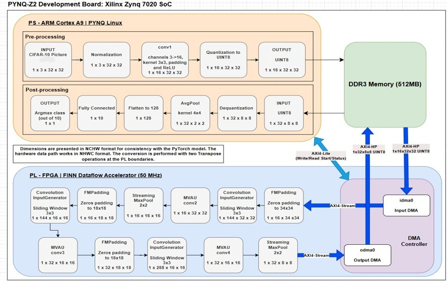

# VGG-Lite on PYNQ-Z2 — an FPGA accelerator for CNN inference

Final project, B.Sc. in Electrical and Electronics Engineering, Ruppin Academic Center (2025–2026).

**Students:** Aviv Holtzman, Dekel Zur Shaday
**Advisors:** Dr. Rafi Cohen, Dr. Benjamin Gur Salomon

A small VGG-style convolutional network (VGG-Lite) is trained with 8-bit quantization-aware training (Brevitas),
compiled with [FINN](https://github.com/Xilinx/finn) into a dataflow accelerator, and run on a PYNQ-Z2 board
(Xilinx Zynq-7020). The heavy middle of the network (conv2–conv4) runs in the FPGA fabric as a pipeline;
the first layer and the classifier run on the board's ARM processor. No HDL was written by hand.



## Key results

All numbers are measured on the board over the full CIFAR-10 test set (10,000 images) and are stored in
[`05_results/results_10k.json`](05_results/results_10k.json).

| Metric | Result |
|---|---|
| Hardware vs. software equivalence | 100.0000% bit-exact (2,048,000 values) |
| Accuracy on the board (INT8) | 70.29% |
| Accuracy cost of quantization (3 seeds each side) | FP32 70.93% vs. INT8 70.82% — not significant (Welch t-test, p = 0.86) |
| Latency, accelerated layers (conv2–conv4) | 75.37 → 11.05 ms (×6.82) |
| Latency, whole system | 97.96 → 40.00 ms per image (×2.45) |
| Throughput, accelerated layers | 51.16 → 8.15 ms per image (×6.28) |
| Throughput, whole system | 57.43 → 19.59 ms per image (×2.93) |
| Pipeline efficiency | 96.5% of the theoretical bound (7.86 ms) |
| Compute rate | 1.45 GOPS at 50 MHz |
| Resources (Zynq-7020) | LUT 93.6% · FF 40.9% · BRAM 10.4% · DSP 10.0% |
| Timing | Met at 50 MHz (WNS +0.503 ns) |

The main finding: the layers left in software are only 7% of the computation but take 72% of the system time,
so the system speed-up is bounded by what was *not* accelerated (Amdahl's law), not by the accelerator.

## Repository structure

```
01_model/          network definition, training, export
02_finn_build/     FINN build script, folding configuration, build reports
03_bitstream/      the bitstream that ran on the board, and its Python driver
04_evaluation/     the final evaluation notebook and its helper scripts
05_results/        every result file the project book quotes, and the figures
07_data/           reference data and weights used by the evaluation notebook
```

### `01_model/` — the network

| File | Purpose |
|---|---|
| `vgg_lite_model.py` | The VGG-Lite architecture in Brevitas (quantized layers, 8-bit weights and activations). |
| `train_vgg_lite_full.py` | Quantization-aware training on CIFAR-10 (Adam, cosine schedule, 20 epochs). Produces `vgg_lite_int8_best.pth`. |
| `vgg_lite_int8_best.pth` | **The deployed model's weights** — the checkpoint the bitstream was built from. |
| `export_to_onnx.py` | Exports the trained model to QONNX, the input format of FINN. |
| `vgg_lite_int8.onnx` | The exported QONNX model that went into the FINN build. |
| `export_weights.py` | Exports the quantized weights to NumPy for the software side of the evaluation. Produces `07_data/sw_weights.npz`. |
| `accuracy_experiment/train_fp32_reference.py` | Trains a true FP32 model with the same architecture and recipe, as a reference for the cost of quantization. |
| `accuracy_experiment/train_qat_seeds.py` | Re-trains the INT8 model with several random seeds to measure run-to-run variation. Never overwrites the deployed checkpoint. |
| `accuracy_experiment/*.pth` | The three FP32 and three INT8 checkpoints (seeds 42, 1, 2) used in the accuracy comparison. |

### `02_finn_build/` — from model to hardware

| File | Purpose |
|---|---|
| `build_vgg_lite_hw.py` | The FINN build script: all build steps, target board, 20 ns clock (50 MHz), and the per-layer folding (PE/SIMD). |
| `custom_folding.json` | The folding configuration applied in the build (parallelism of each layer). |
| `final_hw_config.json` | Hardware configuration of every block: PE, SIMD and memory style, and the FIFO depths chosen by FINN. The build script then caps every FIFO at 512 words; the applied depths are listed in the build log (`[FIFO CAP]` lines). |
| `intermediate_models/*.onnx` | Snapshots of the model during the build. `step_streamline.onnx` is used by the evaluation scripts to reproduce the software side exactly. |
| `report/estimate_layer_cycles.json` | Clock cycles per block (393,216 / 147,456 / 294,912) — the bottleneck analysis. |
| `report/estimate_network_performance.json` | Pipeline estimate: latency of one image through the pipeline (852,961 cycles) and the bottleneck block (393,216 cycles). |
| `report/estimate_layer_resources*.json`, `estimate_layer_config_alternatives.json` | FINN's pre-synthesis resource estimates per layer. |
| `report/op_and_param_counts.json` | MAC operations and weights per layer. |
| `report/post_synth_resources.json` | Resource usage after synthesis (LUT, FF, BRAM, DSP) — the numbers reported. |
| `report/post_route_timing.rpt` | Vivado timing report after place-and-route (WNS, critical path). |
| `time_per_step.json` | Duration of every build step. |
| `build_dataflow.log.gz` | Full log of the build (compressed). |

### `03_bitstream/` — what ran on the board

| File | Purpose |
|---|---|
| `finn-accel.bit` | The FPGA bitstream. |
| `finn-accel.hwh` | Hardware description file that PYNQ needs to load the bitstream. |
| `PROVENANCE.md` | md5 checksums proving these are the exact files that produced the measurements. |
| `driver/driver.py`, `driver/driver_base.py`, `driver/validate.py` | Python driver for the accelerator. **Generated automatically by FINN** (Xilinx, BSD-3 license — see the file headers); not written by us. |

### `04_evaluation/` — measuring on the board

| File | Purpose |
|---|---|
| `Final_Project_Evaluation.ipynb` | **The final evaluation notebook**, run on the PYNQ-Z2. Checks hardware/software equivalence, measures accuracy, latency and throughput on 10,000 images, and writes `results_10k.json`. The saved outputs are those of the reported run. |
| `make_acc_in.py` | Generates the accelerator inputs for all 10,000 test images (`reference_10k/`). Verifies itself bit-exactly against `reference_data.npz` before writing anything. |
| `extract_reference.py` | Produced `07_data/reference_data.npz` by running images through FINN's own model of the network. |
| `compare_models.py` | Evaluates an FP32 and an INT8 model on the same 10,000 images through one code path, with confidence intervals and McNemar's test. Produced `05_results/comparison_seed*.json`. |

### `05_results/` — the numbers

| File | Purpose |
|---|---|
| `results_10k.json` | **Main results**: equivalence, accuracy (overall and per class), latency and throughput broken down by stage, resources. |
| `qat_seeds_summary.json` | Accuracy of the three INT8 training runs. |
| `fp32_log_seed*.json` | Training logs of the three FP32 reference runs. |
| `comparison_seed*.json` | Deployed INT8 model vs. each FP32 seed (accuracy, confidence intervals, McNemar). |
| `predictions_seed*.npz` | Per-image predictions behind those comparisons. |
| `figures/build_figures.py` | Draws the result figures directly from the JSON files above. |
| `figures/*.png`, `*.svg`, `block_diagram.jpeg` | The figures used in the project book and the presentation. |

### `07_data/` — data for the evaluation notebook

| File | Purpose |
|---|---|
| `reference_data.npz` | Reference feature maps for 1,000 test images (accelerator input and expected output). Used for the bit-exact equivalence check. |
| `sw_weights.npz` | Quantized weights of all five layers. The notebook uses them for the parts that run on the ARM (conv1, classifier) and for the all-software baseline. |

## Reproducing the results

The project uses three environments:

| Stage | Environment |
|---|---|
| Training and export (`01_model`) | Python with PyTorch, torchvision and Brevitas |
| Hardware build (`02_finn_build`) | FINN Docker container with Vivado 2022.2 |
| Evaluation (`04_evaluation`) | PYNQ-Z2 board with the standard PYNQ image |

1. **Train** — `python3 train_vgg_lite_full.py`, then `python3 export_to_onnx.py` and `python3 export_weights.py`.
2. **Build** — inside the FINN container, `python3 build_vgg_lite_hw.py` (about 48 minutes). The bitstream appears in the build's `bitfile/` folder.
3. **Prepare the reference inputs** — inside the FINN container, run `make_acc_in.py` with `--build` pointing to the build's `intermediate_models` folder and `--ref` pointing to `reference_data.npz`. It writes `reference_10k/`. This folder is not stored in the repository because it is regenerated deterministically.
4. **Evaluate** — copy to one folder on the board: the notebook, the `03_bitstream` folder, the two files from `07_data`, and `reference_10k/`. Then run the notebook top to bottom.

Notes:
- Several scripts contain absolute paths from our development machine (`/home/avivh/finn/...`); adjust them to your own.
- The build script targets `Pynq-Z1`. It uses the same chip (xc7z020) as the PYNQ-Z2, and the resulting bitstream runs on the PYNQ-Z2.
- The CIFAR-10 dataset is not included; download it from https://www.cs.toronto.edu/~kriz/cifar.html.

## Third-party code

- `03_bitstream/driver/` is generated by FINN and carries the Xilinx BSD-3 license.
- The project builds on FINN, Brevitas and QONNX (Xilinx / AMD, open source).

The full project book (in Hebrew) is submitted separately and is not part of this repository.
